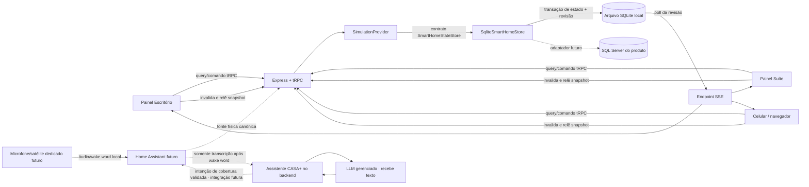

# Arquitetura do backend compartilhado — Casa Inteligente

## Objetivo e status

As centrais touch `/painel/escritorio` e `/painel/suite`, além do painel aberto no celular, são clientes do mesmo backend. Nesta branch, eles compartilham o estado **simulado** de cada ambiente; nenhum endpoint controla equipamentos físicos. O Home Assistant continua sendo o hub escolhido para a futura integração física. A persistência do produto deverá migrar para SQL Server antes de uso comercial ou implantação com múltiplas instâncias.

## Fonte de verdade e componentes

- **React em cada cliente:** consulta o snapshot, envia comandos tipados e mantém somente preferências visuais locais. Estado de dispositivo não é mantido em `localStorage`.
- **API tRPC no Express:** `smartHome.snapshot` lê o estado; `smartHome.command` aplica um comando; `smartHome.scene` aplica cena predefinida; `smartHome.assistantMessage` envia texto ao assistente CASA+ pelo LLM do projeto. As rotas são `publicProcedure` e manipulam somente simulação; nenhuma recebe URL/token do Home Assistant.
- **SQLite local no desenvolvimento:** `.data/smart-home.sqlite` armazena uma linha por ambiente (incluindo `cover_position` de 0–100 ou `NULL` quando não há cobertura) e uma linha global de revisão. A inicialização cria tabelas e migra o campo de cobertura idempotentemente, preservando estados existentes; insere estados iniciais com `INSERT OR IGNORE`. O arquivo é ignorado pelo Git.
- **Limite do SQLite:** todos os painéis conectados ao mesmo backend de desenvolvimento compartilham esse arquivo. O arquivo local não é um banco distribuído, não replica entre contêineres/hosts e não é persistência válida para produção. O endpoint da simulação recusa execução com `NODE_ENV=production` para não sugerir que um arquivo efêmero é banco de produto.
- **Contrato de armazenamento:** `SmartHomeStateStore` isola as operações de snapshot, revisão, comando e cena. `SqliteSmartHomeStore` o implementa no desenvolvimento; um adaptador SQL Server é trabalho futuro e ainda não está conectado.
- **Contrato de provedor:** `SmartHomeProvider` separa a origem do estado consumida pela API. `SimulationProvider` usa o armazenamento SQLite. Um provedor Home Assistant futuro será outro componente; para estados físicos, o Home Assistant deverá ser a fonte canônica, evitando cópias de estado divergentes.
- **MySQL gerenciado preexistente:** continua disponível ao scaffold e aos recursos preexistentes de usuário/autenticação. As tabelas e a migração MySQL da tentativa anterior foram preservadas, sem `DROP`, mas o novo simulador não as consulta nem as atualiza.
- **SSE (`/api/smart-home/events`):** a conexão observa a revisão persistida no armazenamento e envia somente o número da revisão. O evento não transporta estado nem comando.

O diagrama separa duas decisões futuras: SQL Server será o armazenamento do produto; Home Assistant será o hub/origem canônica dos estados de dispositivos reais. Nenhum dos dois adaptadores está implementado nesta branch.

## Fluxo de snapshot e comando

1. Ao montar, ao recuperar foco e ao reconectar o `EventSource`, o cliente solicita `smartHome.snapshot`. A resposta informa `source: "simulation"`, revisão, horário e estados. Ela é a leitura autoritativa; um evento SSE perdido não deixa a tela dependente de memória local.
2. Um comando chega em `smartHome.command`. O schema Zod limita ambiente e capacidade a valores conhecidos. O backend recusa ar-condicionado fora das zonas aprovadas e exaustão fora da cozinha/churrasqueira; temperatura só aceita delta `-1` ou `1` e o SQLite aplica o limite demonstrativo de 16–30 °C. Posições de persianas/cortina aceitam inteiros de 0 a 100 somente nas cinco chaves permitidas.
3. O armazenamento inicia `BEGIN IMMEDIATE`, lê o estado atual, valida a capacidade, atualiza o registro do ambiente (incluindo `cover_position` quando permitido) e incrementa a revisão global na mesma transação. Se qualquer etapa falha, a transação é revertida. O backend só devolve sucesso depois do commit e da leitura do snapshot resultante.
4. A conexão SSE envia a revisão vigente ao conectar. Enquanto aberta, consulta essa revisão a cada segundo e envia um evento `message` quando ela muda; envia heartbeat após período sem alterações e um evento `backend-status` quando o armazenamento cai ou volta.
5. Cada cliente recebe a revisão e invalida a query tRPC, então consulta o snapshot completo. Em nova conexão, o cliente recebe a revisão atual antes de esperar novos eventos. Essa combinação de snapshot autoritativo + notificação de invalidação reduz o risco de estado desatualizado por desconexões.

O acesso ao arquivo SQLite usa transação de escrita imediata para serializar comandos concorrentes na instância de desenvolvimento. Para múltiplas instâncias em hosts diferentes, a revisão e a mudança precisam ser atômicas em um banco compartilhado SQL Server; SSE sozinho não distribui dados.

## Fluxo de cena

`smartHome.scene` aceita somente as cenas enumeradas no código. `cheguei` acende a sala e o escritório; `noite` apaga luzes e desliga climatização apenas nas zonas autorizadas; `sair` apaga as luzes. A cena inteira e o incremento da revisão são gravados numa única transação SQLite. As cenas são demonstrações, sem acionamento físico.

## Assistente CASA+ por texto

`smartHome.assistantMessage` recebe mensagem curta e até oito turnos recentes, obtém o snapshot simulado no servidor e chama `invokeLLM`. O modelo recebe informação de que a casa está em modo de demonstração e só pode sugerir uma ferramenta allowlisted: `set_cover_position`, para um único cômodo entre suíte, quartos 2/3, escritório e sala. O backend valida `deviceKey` e posição novamente com Zod e também verifica deterministicamente a mensagem atual: ela precisa identificar exatamente um cômodo, o tipo correto de cobertura e uma ação/posição explícita que corresponda aos argumentos da ferramenta. Uma tool-call isolada, pedido hipotético ou referência ambígua não altera estado. Somente então o backend usa o mesmo provedor transacional; não há serviço arbitrário Home Assistant. O painel invalida o snapshot após a resposta, enquanto SSE atualiza os demais clientes. A interface lê a resposta em voz alta apenas se o navegador oferecer síntese de fala.

As solicitações são limitadas a 8 por minuto por usuário autenticado ou IP nesta instância, em memória. Essa proteção limita uso casual do LLM, mas não é compartilhada entre instâncias, não é persistente e não substitui login, limites de conta nem proteção de custos do produto.

## Segurança, falhas e limites

- As rotas de leitura/comando da simulação não exigem login nesta versão; qualquer pessoa que tenha acesso à aplicação pode alterar o estado demonstrativo. Não há segredo Home Assistant no browser, no servidor desta branch ou no banco simulado, pois não existe integração real.
- A ausência de autenticação é aceitável somente para a simulação de desenvolvimento. O endpoint LLM é público com limite local de 8 mensagens/minuto, sujeito a abuso/custo; antes de expor produto, exigir autenticação/autorização, proteção de custo compartilhada, validar origem/CSRF, limitar ações a entidades/serviços allowlisted, proteger tokens no servidor e auditar operações.
- Erro de validação devolve falha e não altera estado nem revisão. Falha dentro da transação faz rollback. Falha de snapshot/armazenamento deve ser apresentada como indisponibilidade, nunca como comando concluído.
- Se o SSE cair, `EventSource` tenta reconectar; a query também é refeita periodicamente e ao recuperar foco. O navegador usa o snapshot do backend, não uma cópia local como fonte de verdade.
- O arquivo `.data/smart-home.sqlite` persiste entre reaberturas de página e reinícios do servidor enquanto o ambiente local persistir. Ele pode não sobreviver à substituição do Sandbox ou ao ciclo de vida de um contêiner publicado; não usar como banco do produto.
- A migração SQL Server deverá preservar estado/configuração pertinente e implementar atomicidade equivalente para comando + revisão. Essa implementação requer ambiente e validação próprios; não é coberta pela simulação SQLite.
- A integração real exigirá um Home Assistant instalado e configurado, entidades compatíveis, autenticação, allowlist, mapeamento de cômodos e confirmação de estado real. URL/token não devem entrar no frontend, no controle de versão ou em logs.

## Voz local, wake word e privacidade

O morador escolheu uma palavra de ativação sempre disponível com detecção local na residência usando microfone/satélite dedicado. Isso ainda não está implementado nem deve ser anunciado como ativo: o Home Assistant e o hardware de voz não estão instalados ou conectados. A interface atual não solicita permissão contínua para o microfone.

Há duas topologias locais possíveis que devem ser distinguidas antes da compra. No fluxo padrão documentado pelo Home Assistant, o satélite amostra áudio na sala e pode enviar o fluxo pela rede local ao servidor Home Assistant para detectar a palavra e tratar a fala; esse áudio não precisa sair da residência, mas passa pelo servidor local. Em dispositivos compatíveis, como ESP32-S3-BOX-3, a detecção da palavra também pode rodar no próprio dispositivo com microWakeWord. A frase de ativação e o hardware ainda não foram escolhidos; “Hey Jarvis” é apenas um modelo disponibilizado em alguns dispositivos compatíveis, não uma decisão tomada pelo morador.[1] [2]

Um pipeline totalmente local do Home Assistant pode combinar reconhecimento de fala (por exemplo, Whisper ou Speech-to-Phrase), agente de conversa e síntese de voz Piper no hardware residencial. O suporte e a qualidade em português brasileiro, desempenho do hardware, cobertura acústica e opção de wake word devem ser testados antes de especificar o equipamento.[2] [3]

O CASA+ nesta branch oferece conversa por texto via serviço LLM do projeto. O texto digitado e o snapshot simulado de coberturas são enviados pelo servidor a esse serviço e podem consumir créditos; mensagens não são persistidas pelo aplicativo. Há limite local de 8 mensagens por minuto por usuário/IP, sem garantia distribuída entre instâncias. Nenhum áudio de microfone é capturado, gravado ou enviado pelo protótipo; a interface pode ler respostas em voz alta com a síntese local do navegador/dispositivo, se disponível. O PWA não captura áudio: `SpeechRecognition` tem disponibilidade limitada entre navegadores e, em alguns deles, pode usar reconhecimento em servidor, razão pela qual não serve como substituto presumido para a escuta local contínua solicitada.[4] O assistente só pode modificar posições simuladas de cortinas/persianas por ferramenta allowlisted validada no backend.

**Fontes oficiais:** [1] [The Home Assistant approach to wake words](https://www.home-assistant.io/voice_control/about_wake_word/) — arquitetura de áudio, detecção no servidor, exceções on-device e modelos disponíveis. [2] [Set up a fully local voice assistant](https://www.home-assistant.io/voice_control/voice_remote_local_assistant/) e [ESP32-S3-BOX voice assistant](https://www.home-assistant.io/voice_control/s3_box_voice_assistant/) — pipeline local, componentes STT/TTS e processamento da wake word. [3] [Home Assistant Assist](https://www.home-assistant.io/voice_control/) — arquitetura geral de voz. [4] [MDN SpeechRecognition](https://developer.mozilla.org/en-US/docs/Web/API/SpeechRecognition) — compatibilidade da API e possibilidade de reconhecimento baseado em servidor.

## Decisões futuras

1. Definir versão e hospedagem suportadas para o SQL Server de produto, credenciais e processo de migração.
2. Determinar quais dados ficam em SQL Server (contas, preferências, auditoria e configurações) e quais estados físicos permanecem canônicos no Home Assistant.
3. Implementar e testar a troca do adaptador de armazenamento antes de habilitar múltiplas instâncias, venda ou controle físico.
4. Definir autenticação e papéis das telas fixas e do aplicativo móvel; as duas centrais devem controlar a mesma casa sem duplicar gateways.
